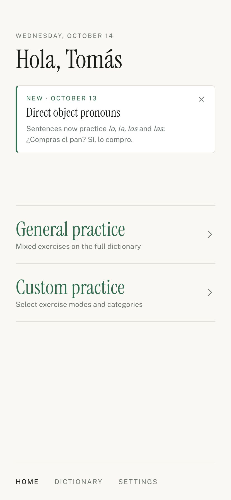
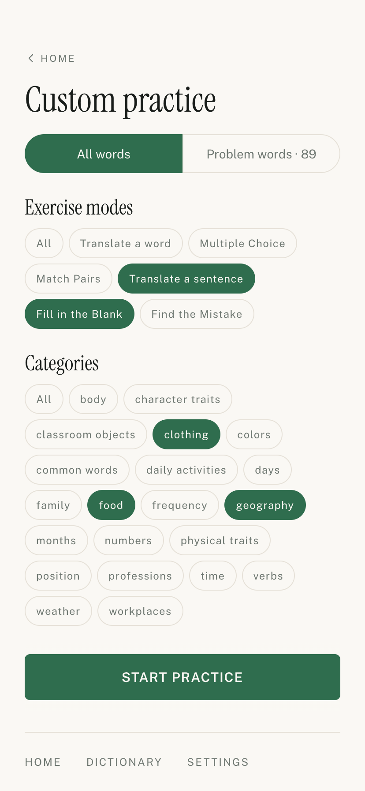
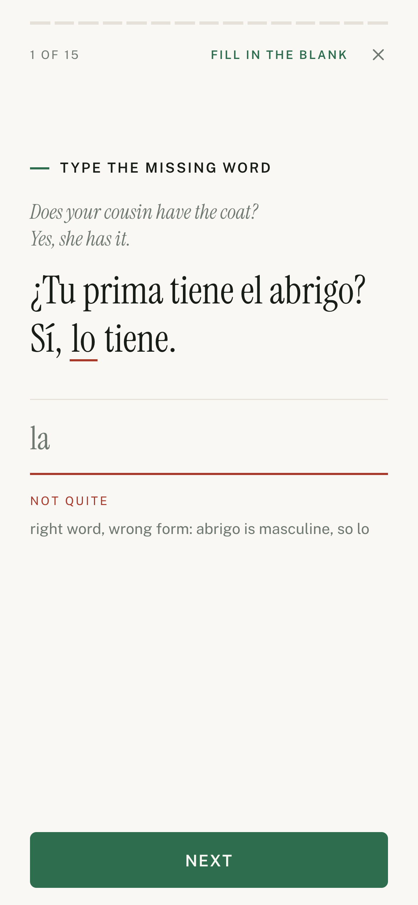
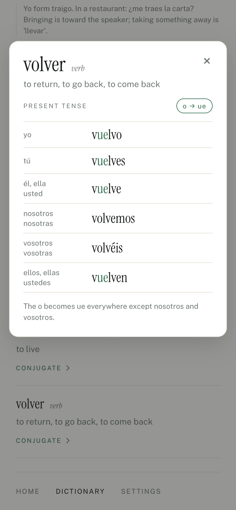

# Spanish vocab

Vocabulary and sentence practice for an elementary Peninsular Spanish class: a searchable
dictionary, spaced-repetition scheduling, and exercises from single words to generated sentences.

<table>
  <tr>
    <td></td>
    <td></td>
    <td></td>
    <td></td>
  </tr>
  <tr>
    <td align="center">Home</td>
    <td align="center">Custom practice</td>
    <td align="center">Fill in the Blank</td>
    <td align="center">Dictionary: conjugation</td>
  </tr>
</table>

It is a **single-user, fully static app**. There is no server and no account: the learner gives a
name on first start, and their progress lives in the browser's local storage on that device.

Dictionary entries are authored **outside** the app — Claude Code writes them into
`data/dictionary.json` following [DICTIONARY_BRIEF.md](DICTIONARY_BRIEF.md), and a deploy ships
them, since the file is bundled into the app. The app itself does the dictionary, the scheduling, and the
drilling, and never calls the Claude API. That is a deliberate decision (see
[Working on the dictionary](#working-on-the-dictionary)): it means no API key, no billing, and no
public endpoint at all.

The app is built together with Claude Code: the code, the design canvases and the dictionary
entries. That is noted here once rather than as a co-author line on every commit.

See [PLAN.md](PLAN.md) for the original spec. Where this README and PLAN.md disagree, this README is
current — notably PLAN.md §6 describes an in-app "add words" flow that is not being built.

## Stack

- **Vite+** (`vp`) — dev server, build, test, lint, format. Not plain Vite; see [AGENTS.md](AGENTS.md).
- **React 19 + TypeScript**, strict mode, React Compiler enabled
- **react-router** in declarative mode
- **zod** as the single source of truth for data shapes — runtime validation and TS types both
  derive from `src/lib/schema.ts`
- **Netlify** static hosting; no functions, no storage
- Plain CSS with CSS modules. No Tailwind, no CSS-in-JS.

## Commands

```sh
vp dev                      # dev server on :5173
vp test                     # run tests once
vp test watch               # watch mode
vp check --fix              # format, lint, and type check
vp build                    # production build to dist/
vp preview                  # serve the production build
```

Run `vp install` after pulling. `vp check` and `vp test` should both pass before committing; the
pre-commit hook runs `vp check --fix` on staged files, and GitHub runs both on every PR (below).
`pnpm dev` runs `vp dev --host`, which also serves the dev server on the local network, for trying
it on a phone.

## Layout

```
src/lib/          pure logic, no React, thoroughly tested
  schema.ts         zod schemas and types for Entry, Dictionary, Progress
  normalize.ts      text folding: case, accents, articles, "tímido/a" shorthand
  grade.ts          answer grading in both directions
  scheduler.ts      SM-2 spaced repetition behind a swappable Scheduler interface
  session.ts        picks the cards for a quiz (and matching rounds), and which english gloss to prompt with
  counts.ts         the home screen's per-word totals (due, new)
  choices.ts        the options for a multiple-choice card
  search.ts         Dictionary search across every form of a word
  conjugation.ts    a verb's present-tense table for the Dictionary, with what to notice marked
  problems.ts       the Problem words list: misses per word, most first, and which words are on it
  forms.ts          a Dictionary card's other forms: el abuelo/a, este/a/os/as, a surprising plural
  releaseNote.ts    the "what's new" notes: which one Home shows, the history, dates and *italics*
  update.ts         when Home checks for a newer build, and whether the live one is newer
  commits.ts        recent commits from GitHub, for the Version screen
  random.ts         seedable shuffle
  sentences/        sentence frames: renderer and checks (frames.ts), gaps (gap.ts), mistakes
                    (mistake.ts), translations (translate.ts), Spanish verb forms (conjugate.ts),
                    English inflection (english.ts)
  dates.ts          ISO calendar-date maths in whole local days
  slug.ts           stable entry ids
src/
  app/            store (context), local storage (local.ts), theme (theme.ts), the update check
                  (update.ts), the bundled
                  dictionary, sentence data and release note, and the shells
  screens/        one file per screen, each with a CSS module beside it
                  (ConjugationDialog is the Dictionary's verb table, a dialog rather than a screen)
    quiz/           one component per exercise (typed and gaps, multiple choice, matching, find the
                    mistake, translate), and the list of them (exercises.ts) Custom practice
                    offers; QuizScreen runs the session
scripts/
  validate-dictionary.ts   schema check with warnings, exits non-zero on error; gates the build
  validate-frames.ts       frame and glue checks against the dictionary; gates the build
  render-frames.ts         prints sample sentences from every frame, for reading through
data/
  dictionary.json          the dictionary, bundled into the app at build time
  frames.json              sentence frames
  glue.json                function words and phrases (clock times) sentences may use
  release-note.json        the "what's new" notes, newest first (see Writing the release note)
design/README.md           links to the design canvases, where screens are mocked up first
docs/screenshots/          the phone screenshots at the top of this README
.github/workflows/         checks on every PR (see Deploying)
```

### Sessions and the on-screen keyboard

Every exercise runs inside `src/app/SessionShell.tsx`, which is sized to the **visual viewport**
(`useVisualViewport.ts`), not the page. iOS Safari does not resize the layout when the keyboard opens
and ignores the `interactive-widget` viewport hint, so anything laid out against `100dvh` ends up
behind the keyboard. The shell is fixed to the visible area instead: header at the top, the action
button directly above the keyboard, and the question between them, scrolling only if it cannot fit.
It also locks document scrolling while open, so iOS has nothing to scroll when it reveals the input.

The shell is a CSS size container named `session`; exercises compact themselves with
`@container session (max-height: …)` rather than media queries, which only see the full screen.

A session is built from progress once, when the quiz screen opens, and kept fixed while it runs.
Progress is read from local storage synchronously on first render, so a session can never start from
empty progress by mistake.

`src/lib` deliberately has no React or network code in it. The grading and scheduling rules are the
part of this app most worth getting right, so they are pure functions with tests rather than logic
tangled into components.

## Screens

- **Welcome** — first start only: asks for a name in Spanish (_¿Cómo te llamas?_, _Tu nombre_,
  _Empezar_), which the home screen greets. The line about progress living on this device stays in
  English: it is a fact about the app, not practice.
- **Home** — two rows the same size: **General practice** ("Mixed exercises on the full
  dictionary"), a mixed session that moves between the exercises, and **Custom practice** ("Select
  exercise modes and categories"). With nothing due or new, General gives way to "Nothing due right
  now"; Custom stays, since it can always offer something. Below them, set apart and quieter, a
  **Problem words · N** row opens the list. It replaced three Focus rows (new words, problem words,
  and a "Select specific exercise mode" toggle) after the "Home focus" boards on the canvas: new words
  already arrive through the reserved share, and choosing modes and categories belongs on one screen.
- **Staying up to date** — an installed app resumed from the background keeps running the build
  it had (on iOS for days), and a home-screen app has no refresh button. So Home asks the site which
  build is live, when it opens and when the app comes back to it, at most every 6 hours
  (`CHECK_EVERY_MS` in `src/lib/update.ts`, the time kept in `vlc-spanish:update-checked`). If a newer
  build is live it reloads quietly — Home is never mid-session, so nothing is lost, and if a session
  has started before the answer arrives it waits for the next visit — then shows "✓ Updated to the
  latest version" in a pill above the nav for about 3 seconds before it fades (a tap dismisses it
  sooner). Board D on the canvas's "Update notice" page; a visible "Update now" prompt (board B) was
  the alternative, but a student who never tapped it would stay behind. The live build is
  `/version.json`, written by the build from the same commit Settings shows (`__COMMIT__`, from
  `commitLabel()` in `vite.config.ts`), and served uncached. Each deploy is its own site, so a PR
  preview compares only with itself, and the dev server never checks. A fresh launch needs none of
  this: the service worker loads the page network-first.
- **What's new** — a short note on Home, under the greeting, about the latest change: a card with
  a green edge, "NEW · 13 OCTOBER ›" (the date in the device's language, like Home's own), a title, a line or two of text and a **×** (board 1 on the
  canvas's "Release note" page; a quieter note at the foot of Home and one in the Dictionary's
  note style were judged too easy to miss). It shows for **7 days from its date** (`SHOW_DAYS` in
  `src/lib/releaseNote.ts`), to new users too, and × fades it out (180 ms, none with reduced motion)
  and hides it on that device for good: the device
  remembers the dismissed note's date, and only a note dated later shows. The file keeps every
  note, but only the latest one that has started ever shows; an older one never comes back. The note does not move the practice rows: an invisible twin of it below them keeps them
  centred where they are without one. Below 740px of screen height (a breakpoint in the CSS) there
  is no room for both, so the twin is left out and the note pushes the rows down. See
  [Writing the release note](#writing-the-release-note). The whole card is a link to **What's
  new** (below, under Settings), every note so far: since a note leaves Home after a week, it is
  how people learn the others are kept. The link is the label's, stretched over the card in CSS,
  so a screen reader hears "New · 27 October, see all notes" rather than the whole note, and × sits
  above it and only dismisses.
- **Custom practice** (`/custom`) — on top, **All words | Problem words · N**; then **Exercise
  modes** and **Categories** as pills, each row led by **All**. Choosing a pill narrows to it,
  several can be chosen, and clearing the last one goes back to All. With Problem words chosen the
  categories grey out rather than hide (board 5e over 5d): the list ignores categories, and the
  choice comes back on All words. **Start practice** sticks just above the nav, since with every
  category listed the end of the page is below the fold on a phone; the shell measures the nav into
  `--nav-height` (safe-area inset included) for it. It builds the URL — `/quiz?scope=all|problems`,
  `exercise=gap,mistake` (one mode gives a session of only that; several, a mix of them), `tags=food`.
  All words uses `scope=all`, so a narrow choice still has words after the due and new ones run out.
  The choices are kept for next time (`vlc-spanish:custom`); there is no summary line and no note
  saying so. The Words and Sentences groups both have a Translate, so the pills say "Translate a
  word" and "Translate a sentence".
- **Quiz** — one prompt at a time, typed answer, inline verdict, progress bar, and a summary
  listing what to look at again. Nouns are prompted with "include the article"; the other way round, a Spanish noun is
  shown with its article (_la manzana_, _el agua_, _el/la estudiante_), as in the Dictionary. A session is full
  screen with no main nav; the × in the header ends it (every answer you have moved past is saved; a
  wrong answer still showing its feedback is saved only when Next is pressed, so it is lost if the
  session is closed first). The header
  names the current exercise in the accent colour. The progress bar and the "4 of 15" counter count
  **words**, not steps — a matching round advances it by four and a two-blank gap by two — so a
  session always reads its full length; counting steps made the same session look a different length
  every time.
  Each card opens with a bold instruction line ("Type the missing word", "Find the wrong word") — in a mixed session the exercise changes
  from card to card, and a muted label was too easy to miss.
  Exercise names, grouped: Words — **Translate** (typed), **Multiple Choice**,
  **Match Pairs**; Sentences — **Translate**, **Fill in the Blank**, **Find the Mistake**. Both groups
  have a Translate; the prompt (one word or a sentence) tells them apart.
  The summary adds a score per exercise when the session used more than one, and is labelled with
  where the session came from: General practice, Custom practice, Problem words, or the exercise's
  name when there was only one.
- **Multiple Choice** — the same session with four options; touching one answers it, with no
  separate Check. A right answer moves on by itself, a miss waits for Next. Keys a–d or 1–4 answer
  and Enter moves on, on a computer. A wrong pick says what the picked word means. Started from
  Custom practice, or by URL: `/quiz?exercise=choice` (combines with `scope` and `tags`).
- **Match Pairs** — rounds of four: English on the left, Spanish on the right, each shuffled; the
  columns share their rows, so a word that wraps to two lines keeps its row level with the other side. Tap
  a tile on either side, then its partner; a right pair locks, a wrong one flashes red and clears.
  Chosen by name it is the session length rounded to whole rounds (four at 15). Rounds were six pairs until that felt tedious to finish. A round draws from one tag where it can and never holds two
  interchangeable words (a shared English gloss or headword). A word matched without ever being in
  a wrong pair is a correct **recognition** answer; both words of a wrong pair count as missed.
- **Fill in the Blank** — the English sentence as a cue, the Spanish with one to three words blanked;
  type each word in the form the sentence needs. Enter writes into the current blank and moves to the
  next, a tap on a blank goes back to it, and Check grades them all. Shares the typed card's input, so the keyboard stays up
  between typed cards and gaps. See [Fill in the Blank](#fill-in-the-blank).
- **Find the Mistake** — the English sentence as a cue, the Spanish with exactly one word broken.
  Tap the broken word, then type what it should be. Tapping a word that is fine ends the card as a
  miss and shows the mistake. Enter moves on from there, as from any miss. See [Find the Mistake](#find-the-mistake).
- **Translate** — an English sentence to put into Spanish. **Not graded**: a sentence has too many
  valid translations to mark one wrong, so after Submit the learner's version and the sentence it was
  rendered from ("One way to say it") sit one above the other to compare by eye. The one verdict it gives
  is **Correct** for an exact match with that version, ignoring capitals, spacing and the closing
  full stop but not accents (`matchesTranslation`), and then only the learner's version is shown, since
  the model would repeat it; anything else gets no verdict, since it may be
  just as right. Nothing is
  scheduled, and the summary counts these as "translated" apart from the score. Enter submits, and
  Enter again moves on: once submitted the text box is gone, so the page listens for it.
- **Problem words** (`/problems`) — every word missed at least once, most missed first, with the
  count and, when the last answer was wrong, "recent miss" (`src/lib/problems.ts`: `lapses` summed over both
  directions; ties put a word still wrong first, then the lower ease). Only a **wrong** answer counts:
  an "almost" (an accent, a one-letter slip) does not put a word on the list (decided 2026-10-14). This is history, so a word
  stays after it is answered right. Reached from the Problem words row on Home. Above the list, beside
  "N words", a small outlined **Practice these** pill opens Custom practice with Problem words
  chosen and the last modes kept, ready to start. It sits at the top rather than below the list, which
  can run well past a screen, and is outlined rather than solid so it does not compete with a
  session's own buttons. A Problem words session (`scope=problems`) drills only words on this list,
  whatever their category, due or not: words wrong last time first, then due ones, then the rest. A row is **swiped left to remove** a word whose misses were only
  slips (a typo in a sentence): it follows the finger over a "Remove" label, slides off past a third
  of its width and the gap closes, or springs back short of that; a drag counts only once it is
  clearly sideways, so the list still scrolls. For the keyboard and screen readers, which cannot
  swipe, each row keeps a remove button that shows only when focused. Removing a word: `forgiveMisses` in `src/lib/scheduler.ts` clears its miss count in both
  directions and, if the last answer was wrong, counts it as right and gives back the ease that miss
  cost. Its due date stays, so it comes back as an ordinary
  review; progress keeps no history, so earlier misses cannot be undone beyond the count. Kept out of the Dictionary on purpose, so the Dictionary stays a
  reference; a subtle marker there may come later.
- **Dictionary** — search both languages (accent-insensitive, so `timido` finds `tímido`), filter
  by tag, read the notes. A card shows a word's **other forms** (`src/lib/forms.ts`): the other
  gender in shorthand on the headword when only the ending changes — _el abuelo/a_, _el
  profesor/a_, _el diseñador/a de moda_, _simpático/a_, _bien comunicado/a_ (a noun phrase changes
  its first word, an adjective phrase its last) — keeping the masculine's article, since
  learners know _el_ becomes _la_; _este/a/os/as_ and _ese/a/os/as_ also take their plural endings,
  with "this / pl. these" beneath. Under a noun the English pairs the same way when the feminine's
  differs ("nephew / niece"). A feminine that drops an accent is written out (_el bailarín / la
  bailarina_), and a different word is not paired at all: _padre_ and _madre_ each have their own
  entry. The grammar label adds a plural worth knowing, one that is not just the word plus -s or -es
  (_noun · pl. lápices_, _pl. jerséis_, _pl. lunes_), or that a noun is _always plural_ (_las gafas_)
  or has _no plural_. Chosen on the canvas's "Dictionary forms" page (board D, plus board C's
  plurals): writing out both forms made the headword long, _el/la abuelo/a_ was too busy, a separate
  forms line made every card taller, and forms only in the label were easy to miss. The search field is a pill with a magnifier, like the category buttons
  below it: as a hairline underline it read as part of the page and was easy to miss. With something
  typed it grows an × that clears it and puts the cursor back, for starting the next search. The tags fold behind a **filter pill** under the search field
  (option 2 on the "Spanish App Screens" canvas, first called "Dictionary Category Filter"): wrapped
  in full they took most of the screen and pushed the results behind the phone keyboard. The row is one
  control — it names the filter ("All categories", or the chosen tag), opens the grid, and once a tag
  is chosen turns accent-coloured, **centres itself** over the list and grows an × that clears it;
  centring is what makes an active filter obvious. Picking a tag folds the grid away. A green filter icon marks it as a
  control: it started as a quiet small-caps toggle and was too easy to miss. With no filter on the
  row is two tabs — **All categories | Verbs only** (`QUICK_TAG`) — for the one category common
  enough to deserve a single tap; choosing it sets the filter like any other, so the tabs give way to
  the filtered row.
  Every verb card has a **Conjugate** link that opens its present tense in a modal dialog over the
  list (`ConjugationDialog`, a native `<dialog>`: Escape or a tap on the dimmed list closes it). The
  table (`src/lib/conjugation.ts`) colours what to notice: a changed stem (_pref**ie**ro_, not in
  nosotros/vosotros), the endings of a regular verb, a whole irregular form (_voy_, _salgo_), and mutes
  a reflexive pronoun; tags beside "Present tense" name the pattern (_e → ie_, _irregular yo_,
  _reflexive_). Verbs marked `verb.pattern: "gustar"` get two columns instead, one thing and several
  (_me gusta / me gustan_), with no tag: a "works backwards" label was mocked up and dropped as
  unhelpful. Search (`src/lib/search.ts`) matches any form a learner might type: the
  feminine and plural (`hermana`, `zapatos`, `estas`), every present-tense verb form (`prefiero`), and
  the English for those (`sister`, `these`). A leading article is ignored (`la mesa`, `the table`), as
  are apostrophes; `ñ` stays distinct from `n`. Exact matches come first, then words starting with
  the query, then any containing it. Forms other than the headword (a feminine, a plural, a conjugation)
  match only whole or from the start of a word, and verb forms are indexed without their reflexive
  pronoun, so `nos` does not list every reflexive verb or every plural ending in -nos.
- **Settings** — your name (editable), **session length** and **appearance**, and how much you have
  practiced. No other users, no switching. Session length is 10, 15 (default), 20 or 30 words, for
  every kind of session (General practice, Custom practice, a single exercise; Match Pairs rounds to
  whole rounds); a `size` in the URL still overrides it. Appearance is Light or Dark with no
  "System" choice: until one is picked the app follows the device and Settings shows whichever that
  is, and once picked it sticks. It is a `data-theme` attribute on the root that the dark tokens in
  `src/index.css` key on, set before first paint by a small script in `index.html` so a dark choice
  never flashes light; the status bar colour (`theme-color`) follows it. Both are kept in local
  storage (`vlc-spanish:theme`, `vlc-spanish:session-size`).
  A quiet footer shows the **version**: the commit the build came from (`COMMIT_REF` on Netlify, `git
rev-parse` locally, marked "+ local changes" when the tree is dirty), injected as `__COMMIT__` by
  `define` in `vite.config.ts`. It opens **Version** (`/version`), which lists the last ten commits
  with their messages, **read from GitHub when the screen opens** (`src/lib/commits.ts`, the public
  repo's API, no key): baking them into the build would go stale on the next push, and the messages
  are only interesting with a connection. The commit this build came from is marked in the list,
  under a line saying these are the most recent. Across from the version in the footer,
  **vlc-spanish@github ↗** (GitHub's mark, an arrow out) opens the repository in a new tab, for anyone
  chasing the details.
  Offline it says so and still shows the build's own commit, which is baked in; the browser's own
  cache often answers anyway.
  Above the version, a **What's new** row (with the latest note's title and date under it) opens
  **What's new** (`/whats-new`): every release note whose date has come, newest first, the latest
  marked, each with its date, title and text as Home showed it, and a link on to Version at the foot.
  The row is hidden while there are no notes. Boards A1 and A2 on the canvas's "Release note history"
  page; the other options put the notes inside the Version screen, beside or among the commits
  (board D threaded each note above the change that shipped it). The notes are written for
  learners and the commits for the developer, so they get separate screens, one tap apart.

## Data

The dictionary ships with the app (see [Working on the dictionary](#working-on-the-dictionary)).
Everything else lives in the browser's **local storage** (`src/app/local.ts`), under seven keys:

- `vlc-spanish:name` — the name given on first start.
- `vlc-spanish:theme` — `light` or `dark` once chosen in Settings; absent means follow the device.
- `vlc-spanish:session-size` — words per session from Settings; absent means 15.
- `vlc-spanish:custom` — the last Custom practice choice: which words, and the chosen modes and
  categories (empty lists mean All).
- `vlc-spanish:note-dismissed` — the date of the last release note dismissed with ×; a note dated
  later shows, an edit to the same note does not.
- `vlc-spanish:update-checked` — when Home last asked which build is live; it asks again after 6
  hours. (Session storage also holds `vlc-spanish:just-updated` for the moment between reloading
  onto a newer build and saying so.)
- `vlc-spanish:progress` — one scheduling record per entry per direction (`en→es` and `es→en` are
  separate cards, and a word is normally practiced in one direction before the other). It is saved
  whenever an answer is recorded — as a card is left, so a right answer straight away and a wrong
  one when Next is pressed — and leaving mid-session loses nothing else.

The progress records still carry a `userId`, from when the app had several users on a server; it is
always `"me"` (`LOCAL_USER`), which keeps the schema valid without a migration.

What local storage means in practice:

- **Progress belongs to one browser on one device.** A phone and a laptop are separate learners.
- **Browsers may clear it.** Safari deletes storage for sites not visited in seven days unless the app
  is installed to the home screen. The app asks for persistent storage on start
  (`navigator.storage.persist()`), which browsers are free to refuse.
- **Unreadable data starts empty** rather than breaking the app, as does blocked storage (private
  windows): the session still works, it is just not remembered.

Until September 2026 users and progress lived in Netlify Blobs behind two unauthenticated
functions. They were removed to make the app single-user with nothing stored remotely; production
progress was deliberately not migrated.

**Numbers are in the dictionary but not in the drill.** They are a large share of the entries, which
crowded out the words that carry meaning, so `isDrillable` in `src/lib/session.ts` holds back
anything tagged `numbers`. They are still searchable in the dictionary, and a session that asks for
that tag by name (Custom practice, or `/quiz?tags=numbers`) still serves them. The home-screen counts apply the same
predicate — a count that includes words no session will offer promises practice the app cannot
deliver.

**Words versus cards.** The dictionary holds twice as many cards as words, because each word is
scheduled separately in each direction. The home-screen totals are deliberately counted **per word**
(`src/lib/counts.ts`): a word counts as new only when it has been practiced in neither direction,
and as due when either direction is ready. That matches what a session serves, since a mixed session
asks each word at most once. Counting cards instead produces totals that exceed the dictionary size
and a "new" count that ignores words drilled spanish → english.

## Writing the release note

The notes are `data/release-note.json`, shipped with the build like the dictionary: every note
so far, **newest first**. Home shows only the latest one that has started.

```json
[
  {
    "date": "2026-10-23",
    "title": "Barrios",
    "body": "New words for the city and neighborhood unit, and sentences that practice *hay* and *estar*: …"
  },
  {
    "date": "2026-10-13",
    "title": "Direct object pronouns",
    "body": "Sentences now practice *lo, la, los* and *las*: ¿Compras el pan? Sí, lo compro."
  }
]
```

- **When**: edit it in the same push as the change it announces. `date` is the first day it shows,
  normally the deploy day; it then shows for 7 days, so an old note simply stops showing and there is
  nothing to remove. A future date waits until that day.
- **Text**: a title of a few words and a body of a sentence or two. Spanish words go in
  `*asterisks*` for italics; there is no other formatting.
- **A new note** goes at the top and needs a **later date**: a dismissal is remembered as the
  dismissed note's date, so a new note shows to everyone, while fixing a typo in the current one
  does not bring it back. Old notes stay in the file as the history, listed under Settings → What's
  new; they never show again on Home.
  Two notes may not share a date (the schema refuses it, since the second would never show).
- **No note**: an empty list. A file that does not parse shows no note rather than breaking Home,
  and fails the tests (`src/lib/releaseNote.test.ts`), so CI catches it, along with notes out of
  order.
- **What earns a note**: usually a big new chunk of words or grammar (a new grammar topic, a large
  word batch), and not much more than one a week, so everyone gets a chance to see each one.
  Smaller changes show in the recent commit history (Settings → Version). When a new branch starts,
  Claude Code says how old the current note is and offers a draft if the work might deserve one.

## Working on the dictionary

`data/dictionary.json` is the source of truth, it lives in git, and it is **bundled into the app at
build time** (`src/app/dictionary.ts`). There is no copy of it in Netlify Blobs and no import step:
publishing words means committing the file and pushing, and the Netlify deploy ships them.

There is no way to add words from inside the app — that is deliberate. New words are written into
`data/dictionary.json` by Claude Code in this repo, following
[DICTIONARY_BRIEF.md](DICTIONARY_BRIEF.md). This keeps the dictionary version controlled and reviewable, and it means
the deployed site has no endpoint that writes words at all.

### Adding words

1. Give Claude Code the class list, in the form used so far:

   ```
   INPUT - character traits
   dormilón/ona, sano/a, perezoso/a, trabajador/a, deportista, intelectual
   ```

   The header names the section, which becomes the tag; `/a` shorthand gives the feminine form.
   **A header that is not an existing tag is checked against the tags there are first**: if it looks
   like the same section under another name ("jobs" for `professions`, "routine" for
   `daily-activities`) or overlaps one, Claude Code asks whether to use the existing tag before
   writing anything. Section names drift from class to class, and two tags for one topic would split
   its words across the Dictionary filter, matching rounds and sentence frames. It
   writes the entries, runs the checks below plus ones the validator cannot do (English glosses
   shared with existing words, headwords one letter apart, sample answers through the grader), and
   marks anything it had to guess as `flagged`. It also reads `render:frames` output for sentences
   using the new words, adds them to frames where they fit, and writes frames for a new section
   (see [Sentence frames](#sentence-frames)).

2. Resolve anything marked `flagged` — check the spelling or sense against the class list,
   then delete the `flagged` field. Fix spellings **before** committing: `id` is derived from the
   headword, and progress is keyed by `id`.
3. Validate:

   ```sh
   vp run validate:dictionary
   ```

   Errors fail it; warnings (flagged entries, ids that are not the slug of the headword, a verb with
   no "to …" gloss) are for you to read. The same script runs first in the Netlify build, so a file
   that does not validate fails the deploy rather than reaching the app. `vp test` also parses the
   bundled file.

4. Optionally check them in `vp dev` — a restart is not needed, the file hot-reloads.
5. Commit and push. The words are live when the deploy finishes.

### Deleting or renaming

Edit or remove the entry and deploy; the file replaces the old dictionary wholesale. Progress is
keyed by entry id and stored on each device, so **changing an id orphans that word's progress** — the
word starts again as new. Orphaned progress rows are harmless and ignored when scheduling. Correcting
the `es` text without touching the `id` keeps progress intact, at the cost of an id that no longer
matches the headword (the validator warns).

### Why not Blobs

Until September 2026 the dictionary lived in Netlify Blobs, pushed there by an import script through
an unauthenticated `POST /api/entries`. That design came from the original plan for in-app word
adding. Once words were only ever authored in git, the Blobs copy was a second source of truth kept
in sync by hand, with a public write path and a `--url` flag that silently imported into the local
store if you forgot it.

## Sentence frames

Sentence exercises draw on `data/frames.json`: hand-written sentence patterns whose slots are filled
from the dictionary. The frame supplies the word order in both languages; the renderer
(`src/lib/sentences/frames.ts`) supplies only what the dictionary data makes reliable:

```json
{
  "id": "family-is-trait",
  "es": "Mi {n} es {a}.",
  "en": "My {n} is {a}.",
  "slots": {
    "n": { "kind": "noun", "tags": ["family"], "number": "sg", "exclude": ["mujer"] },
    "a": { "kind": "adj", "tags": ["physical-traits", "character-traits"], "agree": "n" }
  },
  "cloze": ["a", "n"]
}
```

- **Slots** select entries by `tags`, `ids` and `exclude`. Kinds: `noun` (with `number`, and `agree`
  to take another noun's gender — _Mi hermana es enfermera_), `adj` (agrees with a noun slot), `verb`
  (`subject` is a fixed person, `"@"` for the frame's `subjects`, or a noun slot), `word` (adverbs,
  phrases, numbers as-is) and `glue` (a group in `data/glue.json`). A demonstrative is an `adj` slot
  placed before its noun (`{d} {c} es {a}` → _Esta chaqueta es nueva_), so it agrees, can be blanked
  and can be broken by Find the Mistake like any adjective; an adjective's `enPl` gives English that
  changes in the plural (_these_, _those_). A noun slot's `gender` pins it (`"m"`, `"f"`) for a sentence that only
  works one way — a beard belongs to _mi padre_, never _mi madre_ — and a word that cannot take that
  gender is passed over rather than rendered the other way.
- **Glue words that are also entries** (`muy`, `bastante`, `también`, `cuando`) may fill a slot before
  they are practiced, as they could when they were only glue, so a frame like _Mi tío es {q} alto_
  keeps working for a new learner. A sentence is only ever _aimed_ at a practiced word, though, and
  only practiced words are blanked, so a glue word is never asked before it has been met.
- **Gustar-type verbs** (`gustar`, `encantar`): a verb slot with `liked` naming the slot of what is
  liked renders the person's pronoun plus the verb agreeing with that thing — _me gustan los zapatos_,
  _le gusta leer_, _a mis padres les encantan_ — while the English stays subject-first (_I like shoes_).
  What is liked is a noun slot or a verb slot with `subject: "inf"`, which renders the infinitive and
  counts as singular. Gap grading treats _me gusta_ for _me gustan_ as wrong (not a near miss) and
  says why; Find the Mistake breaks exactly that agreement.
- **Direct object pronouns** (`lo`, `la`, `los`, `las`, frames tagged `object-pronouns`): a
  question and its answer — _¿Compras el pan? Sí, lo compro._ / _¿Queréis las servilletas? No, no
  las queremos._ A `pronoun` slot agrees with a noun slot (`agree`), so _el agua_ gets _la_; in
  English it is _it_ or _them_. A verb slot with `same` repeats another verb slot's verb in its own
  person (compras → compro); it lists the same `ids`, which the validator checks, so Fill in the Blank
  knows which verbs can sit there. **People** too: a `pronoun` slot with `person: true` says _him_,
  _her_ or _them_, with _ver_, _visitar_, _escuchar_ and the personal _a_ — only in the answers that
  say how often (below: _¿Ves a tu prima? Nunca la veo_, _¿Escuchas a la cantante? La escucho todos
  los días_). Plain yes/no versions (_¿Ves a tu hermana? Sí, la veo_) were dropped as dull: they made
  up much of a family session. **Third person**: a relative asks
  and answers for themselves — _¿Tu madre compra el pan? Sí, lo compra_ ("Does your mother buy the
  bread? Yes, she buys it"), _¿Tus abuelos quieren la ensalada? Sí, la quieren_; the English uses two
  placeholders made for it, `{v:base}` (the bare verb after _does_/_do_) and `{n:pronoun}` (_he_, _she_
  or _they_ for a noun slot). Standard _lo/la_ only: the class has not met leísmo (_le veo_), so in a
  gap _le_ or _les_ is `wrong`, with a note that _le_ is the indirect object (_le gusta_).
  Two more patterns carry a thing from one clause or sentence to the next: **two actions joined by
  _y_** — _Compro el vino y lo bebo_, _Traes los platos y los pones en la mesa_ (verb pairings chosen
  by hand, like the cooking frames) — and **a thing mentioned first, then the pronoun**, which also
  puts the frequency words in sentences: _Tengo una chaqueta blanca. La llevo todas las semanas_,
  _Mi tía tiene un abrigo verde. Lo lleva a veces_. Those leave out vosotros, since "You (plural)"
  twice in two short sentences reads badly. Every sentence in a frame now starts with a capital, in
  both languages, including a second one that starts with a slot (_…blanca. **La** llevo…_), and Find
  the Mistake keeps that capital on a broken word.
  **Answers that say how often** instead of _sí_ or _no_ (frames `often-*`, tagged `frequency` too):
  _¿Ves a tu prima? **Nunca la** veo._ — no _no_ with _nunca_ before the verb — _¿Bebes café? **Lo**
  bebo todos los días._, _¿Compras huevos? **Los** compro todas las semanas._ A short adverb
  (_siempre, nunca, a veces, a menudo, normalmente_) goes before the pronoun and a longer phrase
  (_todos los días, una vez a la semana_) after the verb, as Spanish usually puts them; English keeps
  its own order (_I never see her_, _I see her every day_). Things asked about in general take no
  article (_¿Bebes café?_), and the pronoun still agrees (_agua_ → _la_). Spouses are left out of the
  people frames: "I see my wife once a month" reads oddly. Pronouns with an infinitive (_lo quiero
  comprar_) wait until the class reaches them. Each pronoun is a dictionary entry (tagged
  `common-words`), so a blank on one is scheduled like any word; DIRECT_OBJECT in `frames.ts` maps
  gender and number to the pronoun. Because the pronoun is what these frames are for, they test it
  whatever word they were aimed at: a gap always blanks it (as a second blank, past `BLANK_ODDS`,
  when the session has room), and a mistake breaks it `PRONOUN_SHARE` (75%) of the time — its gender
  (_lo_ for _la_) or number (_lo_ for _los_) — recording the answer against the pronoun. The four may
  come back within a session: aimed only at the pronouns themselves, a session met each of the four
  once, so few items tested a pronoun at all. Typed as word cards, another of the
  four is `wrong` with a note ("la stands for a feminine singular noun; lo, a masculine singular one"),
  not a one-letter slip and not a wrong article; _los_ and _las_, which share "them", keep the usual
  near miss and their hints. The question and the answer sit on two lines: the frames write `\n`
  between them, the sentence displays keep it (`white-space: pre-line`), and a typed translation on
  one line still matches, since spacing is ignored. Known and left for now: the pronouns are tagged
  `common-words`, so a Custom practice session on a category never blanks them, but Find the Mistake
  still breaks the pronoun in these frames now and then. Making it respect the category is a small
  change if it starts to bother. Pronoun frames take a share of General practice in proportion to
  their number, and more of a Custom practice session on the categories they use (clothing, family,
  food); they still practise the word they are aimed at.
- **Placeholders**: `{slot}`, plus `{slot:el}` / `{slot:un}` for a Spanish article and `{slot:the}` /
  `{slot:a}` for an English one; `{v:not}` gives a verb's English negative with do-support
  (_don't like_, _doesn't go_, _isn't_) for frames that put _no_ before the Spanish verb; `{slot:none}`
  renders nothing, for a slot the English does not say word for word — _¿Me pones un café?_ is
  "Can I have a coffee?", with no "put" in it — and Find the Mistake never swaps such a slot for
  another word, since with no cue to give it away the swap could be just as right; `{S}` is the subject pronoun. `vosotros` renders as "you (plural)".
- **The renderer handles** gender and number agreement, verb forms (stored forms, then regular
  endings, then a multi-word verb's first word through its own entry), articles, `a el → al` /
  `de el → del`, `y → e` before an _i_ sound, English third-person _-s_ and irregulars, _one's_ →
  _his/her/..._, English plurals and _a/an_. A person noun is put in the feminine only if it has
  `enF`, the English for its feminine form. For a person slot whose gender is free, the gender is
  decided first (50/50) and then a word that can take it is chosen; deciding per word let the
  always-masculine plurals (_los padres_, _los abuelos_) tip sentences toward the masculine.
- **Words whose English is a noun** (_comilón_ "big eater", _dormilón_ "sleepyhead") are excluded
  from trait frames: "My son is very big eater" is what including them produces.
- **Word pairings are the frame's job.** Routines are split by time of day so morning activities get
  morning times — without that the renderer happily produces _desayunamos por la tarde_.
- **Questions** (tagged `questions`), two kinds. **With an answer**, mostly on barrio words:
  _¿Dónde está el cine? Está cerca del parque._, _¿Cómo es tu barrio? Es tranquilo._, _¿Cuántos
  parques hay en tu ciudad? Hay muchos._, _¿Qué hay en tu barrio? Hay un cine._, _¿Quién vive en el
  norte? Mi tía._, _¿Cuándo vas al cine? Los sábados._, _¿Por qué llevas un abrigo? Porque hace
  frío._ **On their own**, for Translate and Fill in the Blank: _¿Dónde trabaja tu madre?_, _¿Dónde
  están tus gafas?_, _¿Cómo es tu hermano?_ ("What is your brother like?") beside _¿Cómo está tu
  madre?_ ("How is your mother?") for ser against estar, _¿Cuántas primas tienes?_ and _¿Cuánta
  agua bebes?_ for all four forms of _cuánto_, _¿Qué haces los sábados?_, _¿Quién es la
  camarera?_, _¿Cuándo te levantas?_, _¿Por qué no vas al cine?_, and for _cuál_ _¿Cuál es tu
  chaqueta?_, _¿Cuáles son tus botas?_ and _¿Cuál prefieres, el té o el café?_. _cuál_ gets no
  answers: _La negra_ ("the black one") needs el/la with an adjective, which the class has not met.
  The question word is a `word` slot, often with `{q:none}` in the English, which says it its own
  way ("What is your neighborhood like?" for _¿Cómo es…?_). Fill in the Blank tests the word, a
  missing accent being `hard` and _porque_ for _por qué_ `wrong`; Find the Mistake does not swap
  question words, only _cuánto_'s agreement (_¿Cuánto parques…?_).
- **Weather and seasons** (`weather-*`, `season-*`, `*-place-is`, `my-city-climate`): the weather
  phrases with a month or a season, in pairings that fit (_En invierno nieva_, _En verano hace
  calor_; the compass points too, _En el norte llueve_), and the climate adjectives describing a
  season, a place, a region or the city (_La primavera es
  templada_, _La selva es húmeda_, _Mi ciudad es muy seca_), and _el clima_ with them (_Mi ciudad
  tiene un clima templado_, _El desierto tiene un clima árido_), where agreement is the test:
  _clima_ ends in -a but is masculine. The English drops the article Spanish
  keeps (_El invierno es frío_, "Winter is cold"). The frames that take any `weather` word (_…por la
  mañana_, _…todos los días_) are limited to `pos: "phrase"`, since the category also holds the
  adjectives and seasons: _Frío por la mañana_ is not a sentence.
- **Neighbourhoods** (`barrio-*`, `place-*`, tagged `hay-estar`, `tener`, `position`): describing a
  barrio with _hay_ and _tener_ — _En mi barrio hay un cine_, _Mi ciudad tiene muchos parques_,
  _En mi barrio no hay hotel_ (bare after _no hay_, as Spanish says it) — and saying where a known
  place is with _estar_: _El cine está cerca del parque_, _La biblioteca está entre el banco y la
  tienda_, and both together, _En mi barrio hay un bar. Está al lado de la estación._ _hay_ is a
  dictionary entry filling a `word` slot and _está_ a verb slot agreeing with its place, so Fill in
  the Blank and Find the Mistake can test both. The English keeps _there is_ for _hay_ and _has_ for
  _tener_, so each cue points to one structure. Adjectives describe the barrio, its venues and its
  public places (_Las tiendas de mi barrio son caras_); _pero_ pairs only traits that contrast
  (_moderno pero caro_), never _tranquilo pero ruidoso_. _mucho_ before an uncountable (_mucha vida
  nocturna_) has frames of its own, since its English there is _a lot of_, not _many_; so does
  _Mi barrio tiene mucha vida_, whose English is "My neighborhood is very lively". Two limits:
  sentences about having one of something use only _mi barrio_ (a city with one bus stop reads
  oddly), and a preposition that is a `word` slot (_al lado de_, _delante de_, _detrás de_) only
  takes feminine places, since _de el_ only contracts to _del_ after a frame's own words, as in
  _cerca de_ and _lejos de_.

```sh
vp run validate:frames                     # schema, placeholders, vocabulary, every slot fillable
vp run render:frames -- --per 12           # sample sentences from every frame
vp run render:frames -- --frame days-routine --per 40
```

The validator catches structural problems; only reading `render:frames` output catches sentences
that are grammatical but odd. Read it whenever frames change **or words are added**, since new
words in a tag flow straight into the frames that draw on it.

## Fill in the Blank

`src/lib/sentences/gap.ts`. A gap is aimed at a word: the planner walks the session's priority
order, takes the first word some frame can blank (`frame.cloze`), and renders that frame with the
word pinned in the slot. So a gap usually reviews a word that is due.

- **Sentences use any dictionary word** — practiced here or not. The learner is working through a
  class that has covered the dictionary, so a word the app has not asked yet is not a word they have
  never met, and it is graded like any other. Sentences therefore work from the very first session,
  and they **carry** new words instead of competing with them: they used to be practiced-only, which
  made them eat the session's new-word slots, and a learner met far fewer words. A sentence is aimed first at a word whose `en→es` card is **due** or never asked (a sentence
  is answered in Spanish, so that is the card it reviews), then at the rest of the ranked list, then
  at any other word, the longest unseen first. In a mixed session at most `MAX_EARLY_SENTENCES`
  (4 per 15 words, scaled by `capFor`) sentences go to words that are practiced but _not_ due — an
  early review, which a right answer does not advance (see the scheduler notes).
- **Several blanks**: a gap gets 1 blank half the time, 2 most of the rest, 3 occasionally
  (`BLANK_ODDS`), limited by how many slots the frame lists in `cloze`. The first blank is the word
  the gap was aimed at; the others are further practiced words in the sentence not already used this
  session. Each blank is its own card (`blankCards`), graded and scheduled on its own, and each counts
  as a word toward the session size. Two blanks side by side (_Sí, \_\_\_ \_\_\_._) give no sign
  where one word ends, so both words typed into the first are shared out (`spreadAnswer`): each
  blank takes as many words as its answer has, and the last of the run the rest, as if each had been
  typed in its own blank. Only into blanks right after it, with nothing but a space between.
- **Scheduling**: a gap is always answered in Spanish, so every blank schedules its word's `en→es`
  card as a typed (**recall**) answer, whichever direction the session balanced it to.
- **Grading** (`gradeGap`): the form the sentence needs is correct, and so is the same slot filled
  with any word sharing its English (_almuerzo_ for "I have lunch" where the sentence used _comer_).
  Only an accent wrong is `hard`. **The right word in the wrong form is `wrong`**, since agreement and
  conjugation are what a gap tests, with a note naming the rule: "madre is feminine, so tímida", "for
  nosotros it is comemos". Another dictionary word is `wrong` too (_padre_ for _madre_ is one letter
  away but a different word). A one-letter slip otherwise is `hard`, except at the end of a noun or
  adjective, where gender and number live. Each blank is graded against the sentence as shown, never
  against what was typed in the other blanks.

**Not repeating a pattern**: a session's gaps, mistakes and translations share a record of the
frames they have used (`usedFrames`), and each tries a word's unused frames first (`framesToTry`
in `frames.ts`), falling back to a used one only when nothing else fits that word. Without it a
session could say _Hay cebollas en la mesa_ and then _Hay calabazas en la mesa_, often so in a
single-category session. Repeats are now rare, though family words, which fit few patterns, still
see some; sessions have as many sentences as before.

**Trying out a grammar point**: `/quiz?exercise=gap,mistake&grammar=object-pronouns` keeps a
session's sentences to frames whose `grammar` includes that name (any frame tag works, such as
`gustar` or `negation`; an unknown name leaves every frame in). Word exercises are unaffected, so
name sentence modes in `exercise`. It is for testing new frames and has no control in the app.

## Find the Mistake

`src/lib/sentences/mistake.ts`. Like a gap, a mistake is aimed at a practiced word, due ones first (with the same fallback and cap): the frame is
rendered with that word pinned in a slot, and then **that slot** is broken, only in ways where the
result really reads differently:

| Kind                   | Example                            | Explanation shown                                        |
| ---------------------- | ---------------------------------- | -------------------------------------------------------- |
| agreement (adjective)  | _Mi madre es tímido._              | madre is feminine singular, so tímida                    |
| number (adjective)     | _Mis nietos son perezoso._         | nietos is masculine plural, so perezosos                 |
| agreement (profession) | _Mi mujer es diseñador de moda._   | it describes mujer, who is female, so diseñadora de moda |
| person (verb)          | _Mi primo os vestís a las seis._   | for primo it is se viste                                 |
| number (gustar)        | _Me gusta los zapatos._            | los zapatos is plural, so me gustan                      |
| agreement (pronoun)    | _¿Tienes el queso? Sí, la tengo._  | it stands for queso, masculine singular, so lo           |
| word                   | _Hablo con mi sobrino._ ("cousin") | the sentence means cousin: primo                         |
| hay-estar              | _En mi barrio está un cine._       | hay says what there is: hay un cine                      |
| muy-mucho              | _Mi barrio es mucho tranquilo._    | before an adjective it is muy: muy tranquilo             |

A **word** swap puts in another word that fits the slot exactly as the right one does — same gender
and number (so the article shown stays right), same person for a verb — and that means something
else, so only the English cue gives it away. It never uses a word sharing a gloss or the headword,
since that could be just as right.

**hay and estar** are swapped only in frames tagged `hay-estar`, where the swap is plainly wrong:
_hay_ becomes _está_ or _están_, agreeing with what follows it, and _estar_ becomes _hay_ only when
its subject is shown with _el_ or _la_ (_El cine hay cerca_: "estar says where something known is:
el cine está"). After _hay un cine_, a following _Está cerca_ is never broken that way, since _Hay
cerca_ would not read as a clear mistake.

**muy and mucho**, the mix-up English speakers make between "very" and "a lot": _muy_ becomes
_mucho_ when an adjective follows it (_Mi barrio es mucho tranquilo_), and the adverb _mucho_
becomes _muy_ when it follows a verb (_Trabajas muy_: "after a verb it is mucho: trabajas mucho").
Both are always wrong, so no frame tag is needed; the word beside the slot decides.

**No article swaps** (_Trabaja en una hospital_). They were the easiest mistake to spot and nearly
every noun offered one, so even held to about one mistake in eight they meant reading a whole
sentence, often two, for one letter. Gender is still tested: an English → Spanish noun card wants
its article, and adjectives break their agreement. A noun's mistake is now a word swap.

**Which break is used is weighted**, because uniform choice let whichever kind is always available
take over — first article swaps, then, once word swaps existed, word swaps. A form break
(agreement, number, person, _hay_/_estar_, _muy_/_mucho_) is used `FORM_SHARE` (75%) of the time when
a word also offers a swap. Word swaps still lead, since the dictionary is mostly nouns. The English
cue is always shown: without it a verb in the wrong person can still be a grammatical sentence
(_Vamos al trabajo_ for "I go to work").

- **Tapping**: any word of the broken text finds it, including every word of a phrase (_os vestís_).
- **The fix** (`gradeFix`): the corrected text, or just the one word that changed when only one did
  (_hacemos_ for _hacemos la cama_). Only an accent wrong is `hard`; typing the mistake back is
  `wrong` with its own note.
- **Scheduling**: the broken word's `en→es` card, as a **recognition** answer — correcting a form
  that is put in front of you is easier than producing it, so it is held to the 7-day limit.

## Status

Phases 1 and 2 are complete and deployed at [vlc-spanish.netlify.app](https://vlc-spanish.netlify.app):

- **Dictionary**: bundled from `data/dictionary.json`, searchable across every form of a word, with
  folded categories, a word's other forms on its card, and a conjugation table for every verb
- **Practice**: General practice, and Custom practice for any mix of exercise modes and categories
  or the Problem words list;
  six exercises (Translate a word, Multiple Choice, Match Pairs, Translate a sentence, Fill in the
  Blank, Find the Mistake), SM-2 scheduling with recognition answers held to a week, and a
  per-exercise score in the summary
- **Sentences**: frames built from any dictionary word, including _gustar_, simple negatives and
  direct object pronouns (_lo, la, los, las_),
  from the first session (`vp run validate:frames` prints how many, and
  `vp run render:frames` how many sentences they can make)
- **Problem words**: a list of every word missed, most first, with Practice these
- **What's new**: a release note on Home, written by hand in `data/release-note.json`
- **Settings**: name, session length (10–30 words), light or dark, every release note (What's new),
  and the recent commits
- **Single-user and fully static**: name on first start, everything in local storage, no server;
  installable PWA with the app shell cached offline

Nothing is waiting to be built. Ideas, not commitments:

- **Answer a question** (cued Q&A) or **Odd one out**, as further exercises.
- **More pronoun forms** as the class reaches them: with an infinitive (_lo quiero comprar_ /
  _quiero comprarlo_), commands (_cómpralo_), double pronouns (_te lo traigo_).

Decided against: flashcards, a progress screen and conjugation drills (2026-09-21); grading Translate
word by word with a self-mark (it stays ungraded); a fixed sentence bank, which repeats too often,
and fully type-driven templates, which produce wrong English and odd combinations (frames instead);
a "new" marker on categories (2026-10-14; the release note covers it).

## Choosing words

Every session draws words from `rankedCards` in `src/lib/session.ts`, which sorts them into four
bands:

1. **Due** — reviews whose date has come, **words missed last time first** (`missedFirst`), the
   rest shuffled. A missed word is due the next day, but in a crowd of other due words the shuffle
   often left it out of the next session, so the repeats a learner saw were mostly words they already
   knew; first in line, it comes back at the very next visit. Answered right, it rejoins the rest.
2. **New** — words never practiced in **either** direction, each offered in one direction only.
3. **Other direction** — the unpracticed direction of a word already met. It is not new to the
   learner, so it waits until there are no new words left rather than taking their place.
4. **Rest** — everything else, only for sessions that ask for all words.

Due and new are interleaved so that **every third card is a new word** (`NEW_WORD_EVERY`) while any
remain; with nothing due, a session is all new words. With more than one category chosen in Custom practice, **new words** are introduced from
each in turn (`balanceTags`): in proportion to size, a big category drowned a small one (food against weather),
so a first session could be all food. Reviews are not balanced, and follow the schedule whatever
their category. Balancing them too was tried: it drilled a small category's words several times as
often as a big one's, where balancing new words alone keeps attention per word about even while
every early session still mixes the categories.
A Problem words session has its own order:
words wrong last time, then due, then the rest of the list.

On top of the order, a mixed session **reserves `NEW_SHARE` (40%) of its length for words the app has
not asked yet**: once only that many slots are left, they go to new words whatever the exercise
weights would have chosen. Without it the session fills with reviews — due words come first and every
exercise can use them — and new words dwindled to a trickle within a few sessions.

Why the reserved share: a word answered today comes back tomorrow, then in three days, so without it
the previous day's words fill every session and new words stop arriving after the first day.

## Mixed sessions

A session started from General practice, or from Custom practice with more than one mode, is built by `buildMixedSession` in
`src/lib/session.ts`: the session length from Settings (15 by default), taken in the order described in
[Choosing words](#choosing-words), with only the way each is asked varying. Each step picks an exercise by weight (`MIX_WEIGHTS`): Fill
in the Blank 3, Find the Mistake 2, word Translate (typed) 2, sentence Translate 1, Multiple Choice 1, a matching round 1. Sentence
exercises lead because they test words in context, which is worth more than rote recall. Rules on top:

- **At most two Multiple Choice cards and one matching round per 15 words** (`MAX_PER_SESSION`, scaled
  to the session length by `capFor`, never below one: a 30-word session allows four and two). Multiple Choice is
  recognition among four options, easy enough that more feels like filler. A matching round is several words at once, so two of them took most of a
  fifteen-word session, sometimes back to back.

- **No more than three of one exercise in a row** (`MAX_RUN`), so the pace keeps changing — unless
  nothing else is left to offer (Multiple Choice used up, no room for a round, no sentences), when the
  exercise it stopped continues rather than the session stopping. Typing can always continue, so a
  session with it in the mix always fills its length; one limited to sentence modes ends early if the
  chosen words run out of sentences.
- **Typed cards are nudged into short runs.** Every switch between typing and tapping drops or
  raises the phone keyboard; alternating one card at a time would have it bouncing all session. On
  iOS a typed card that follows a tap exercise may need a tap on the answer line to bring the
  keyboard back, because iOS only opens it from a user gesture.
- **Find the Mistake and Translate join** once sentences are possible, like gaps.
- **Gaps are available from the first session**, nudged into runs with typed cards since both use the
  keyboard — see [Fill in the Blank](#fill-in-the-blank). With nothing due they still appear: up to
  four per 15 words aimed at words practiced earlier, and any number aimed at words not yet asked.
- **Custom practice limits the mix to the chosen modes** (`config.exercises`). The caps above exist
  to keep the easy exercises from crowding out typing, so they apply only when typing is among
  them; without it, a session of Multiple Choice and Match Pairs still fills its length. New words in
  the reserved share are asked by typing, or by Multiple Choice when typing is not chosen; with
  neither, they arrive only as sentences pick them. Extra blanks in a gap come only from the chosen
  words (the category, or the Problem words list).
- **A matching round needs room**: at least four words left in the session and at least three words
  that can share a round. Otherwise the planner stops offering rounds for that session.

Directions are balanced across the whole session at once, then multiple-choice options are chosen.

## Multiple choice

`choices.ts` picks three distractors for each card. A good one is a word the learner could actually
confuse with the answer, so candidates are ranked: same part of speech, then a shared tag, then (for
nouns) the same gender and number so the article cannot give it away, then words already practiced.
Ties are shuffled, so the same question gets different distractors across sessions.

Some words are never offered, because they would make a second right answer: anything sharing an
English gloss with the answer (`ser` for `estar`) or sharing its headword (`deportista` the adjective
for the noun). Numbers are kept out of ordinary questions, and a number asked by name gets number
distractors. Two options never read the same.

A correct pick is a **recognition** answer for the scheduler (see below), a wrong one lapses the card.

## Grading rules

Worth knowing before you change `grade.ts`, because the tests encode all of it:

- **Both directions** ignore capitals, extra spaces, `¿ ¡`, a closing `. ! ?` and apostrophes
  (`normalize`). Apostrophes go because iOS types a curly `’` by default and "its hot" is a slip of
  punctuation, not of the language; Spanish does not use them.
- **en→es**: the feminine or plural of the headword is accepted as correct. For adjectives that means
  all four agreeing forms, worked out like sentences build them (stored `forms.pl`, else the regular
  plural), so _simpáticas_ and _muchas_ count even though only _simpática_ is stored. A missing accent is
  `hard` ("almost — check the accent"), and a `ñ` written as `n` is called out as its own case.
  Nouns are expected with their article; a missing article is `hard`, a wrong one is `wrong`, since
  the article is how gender gets tested. A common-gender noun (`gender: "mf"`) accepts either
  article and is shown as `el/la estudiante`. A noun whose headword is itself plural
  (`number: "pl"`, as in `los hermanos` for siblings) takes `los`/`las`. A noun with no plural at all
  (`number: "sg"`, as in `la ropa interior`) is marked so the validator does not ask for one. A feminine noun
  that takes _el_ in the singular (`elSingular`, as in `el agua fría`) is asked and shown that way,
  with `las` in the plural; it stays feminine for agreement. A noun's `article` field relaxes this for words Spanish
  uses bare: `"none"` for months (answer shown as `enero`) and `"optional"` for days (shown as
  `el lunes`). Either way the article is accepted but not asked for, and a wrong one is only `hard`.
  A noun's `bare` list holds other Spanish said without an article, like a name: _Correos_ for
  _la oficina de correos_ is correct as typed. An other-gender noun (`abuela` for `abuelo`) or a conjugated
  verb (`me acuesto` for `acostarse`) is accepted but downgraded to `hard` rather than silently
  passing — they are different words than the prompt asked for. The exception is a noun whose
  feminine answers to the **same gloss the prompt showed** (`nurse` is both `enfermero` and
  `enfermera`): then either gender is correct, since the prompt cannot have asked for one of them.
  `grade()` is given the gloss shown (`opts.prompt`), so `nieta` is right for "grandchild" and only
  "almost" for "grandson".
- **es→en**: a leading `to` or `the/a/an` is stripped before comparing, and any gloss listed in the
  entry's `en` array counts. So does a gloss of any other entry whose **prompt looks the same**:
  _mucho_ the adjective and the adverb both show "mucho", so "many" and "a lot" are right on either
  card. A noun's prompt carries its article, so _el este_ ("east") does not take "this", nor _la
  mañana_ "tomorrow".

When nothing matches, three checks run in order before an answer is called wrong — each exists
because the naive version of the rule gets a real case wrong:

1. **An article-only difference is a gender mistake**, not a slip: `lavarse las dientes` stays
   `wrong`, since gender is the thing being tested.
2. **An answer that is itself another headword is a confusion**, not a typo. The dictionary holds
   many pairs one edit apart — `junio`/`julio`, `padre`/`madre`, `sesenta`/`setenta`,
   `llegar`/`llevar`, `este`/`ese` — so forgiving
   single-character slips blindly would mark a real mistake as nearly right. The feedback names what
   you actually wrote instead.
3. **Anything else within one edit is a typo** → `hard`, "check the spelling". The distance is
   Damerau-Levenshtein, so a transposition costs one rather than two — swapped letters are the
   commonest slip there is. Exception: an edit to the _last_ letter of a noun or adjective stays
   `wrong`, because Spanish keeps gender and number there, and `inteligenta` is a claim about the
   language rather than a fumbled key.

Some English glosses are claimed by more than one word — `to be` is both `ser` and `estar`. The
session builder prefers a gloss no other entry uses. Where none exists, the entry's `hint` is shown
beside the grammar line (`verb · identity, traits, origin`) so the prompt says which word it wants.
A hint shows whenever an entry has one, also for a gloss that is the entry's own but points at a more
common Spanish word outside the dictionary: "time" alone gets _tiempo_, so `vez` shows
`noun · as in once, twice`,
(`promptDetail` in `src/screens/quiz/shared.ts`; a noun's line names no gender — the article is what
the prompt is testing, so it would answer the question),
and the rival entries are passed to `grade()` so answering `estar` for `ser` explains the difference
instead of just failing. The validator warns about any entry with no gloss of its own and no hint.

Three results feed the scheduler: `correct` advances normally, `hard` advances with reduced ease,
`wrong` lapses the card to tomorrow. The ladder for a word is 1 day, then 3, then the interval times
its ease — except that a word **typed right on its very first asking** starts at
`KNOWN_FIRST_INTERVAL` (4 days) and skips the 1- and 3-day steps: the class has covered the
dictionary, so it is usually known, and for a student practising twice a week the 1-day step made
every word from one visit due again at the next. A miss, an "almost", or a first answer picked
rather than typed takes the usual ladder, and so does a word relearned after a miss. Answers also carry a strength. Typing is **recall**; picking the
word out of a set (multiple choice, matching) is **recognition**, which is weaker evidence, so a
correct recognition answer leaves ease alone and can never schedule a word more than
`RECOGNITION_MAX_INTERVAL` (7) days out. It never shortens an interval already earned by recall, and a
wrong recognition answer lapses the card like any other. **An answer before the card is due** (a
sentence reaching for a word practiced earlier) records the result and the day but, when right, leaves
the schedule alone: minutes after learning a word, a right answer is no evidence it will last three
days, and advancing on it pushed words out early. A wrong early answer lapses the card as usual. A correct answer auto-advances after `CORRECT_PAUSE_MS`
(550ms); anything else waits for the button, because there is something to read.

## Deploying

Hosted on Netlify at `vlc-spanish.netlify.app`, deployed from the GitHub repo. The site name is a
property of the Netlify site, not something in `netlify.toml` — it is set at creation
(`netlify sites:create --name vlc-spanish`) or in the Netlify UI.

The site is fully static: `pnpm run build` validates the dictionary and frames, type-checks and
builds to `dist/`, writing `version.json` beside the app for Home's update check. There are no
functions and no environment variables. `netlify.toml` serves `sw.js`, the manifest and
`version.json` uncached.

**Checks on GitHub** (`.github/workflows/checks.yml`) run on every pull request and every push to
`main`: `vp check` (format, lint, types), `vp test`, and the dictionary and frame validators, on
Node 22 like the Netlify build. They are separate from deploying — the Netlify build stops only on a
validator or type error, not on a failing test — so a red check on a PR is the signal to look before
merging.

If the old Netlify Blobs store still holds data from the multi-user version (`users`,
`progress/dylan`, `dictionary` in the `vocab` store), nothing reads it; with the CLI linked to the site
(`netlify link`) it can be removed with `netlify blobs:delete vocab <key>`.
